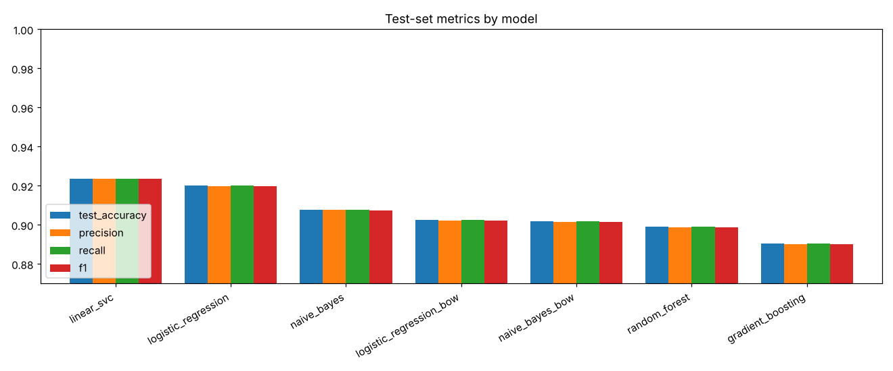
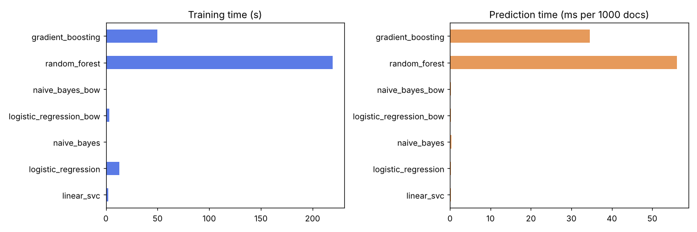
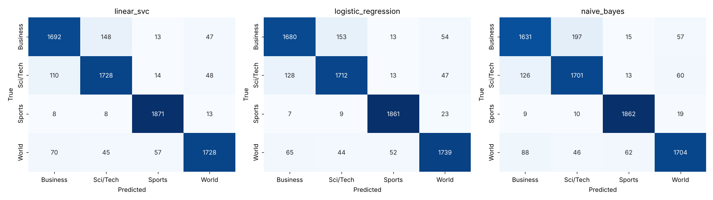

# AG News Classification — End-to-End NLP System

[](https://github.com/Kartiken07/NLP-PROJECT-1/actions/workflows/ci.yml)


**An end-to-end NLP system for classifying news articles into World, Sports, Business, and Sci/Tech using classical machine learning.**

Built on the **AG News** dataset with **120,000 training** and **7,600 test articles**, the project covers the complete workflow from exploratory analysis and text preprocessing to feature engineering, model comparison, calibrated inference, and a Flask web application.

```text
AG News
   ↓
Text Preprocessing
   ↓
BoW / TF-IDF
   ↓
7 Model Configurations
   ↓
LinearSVC + TF-IDF
   ↓
Probability Calibration
   ↓
Flask API + Web Interface
```

| Final Model | Test Accuracy | Weighted F1 |
| --- | ---: | ---: |
| **LinearSVC + TF-IDF** | **92.36%** | **0.923** |


## Results (AG News test set, 7,600 articles)

| Model | Features | Accuracy | Weighted F1 |
|-------|----------|---------:|------------:|
| **LinearSVC (selected)** | TF-IDF (1-2 grams) | **92.36%** | **0.923** |
| Logistic Regression | TF-IDF | 92.00% | 0.920 |
| Multinomial Naive Bayes | TF-IDF | 90.76% | 0.907 |
| Logistic Regression | BoW | 90.24% | 0.902 |
| Naive Bayes | BoW | 90.18% | 0.902 |
| Random Forest | TF-IDF (chi2 top 20k) | 89.89% | 0.899 |
| Gradient Boosting (HistGB) | TF-IDF + SVD(200) | 89.04% | 0.890 |

### Model Comparison

<p align="center">
  
</p>

Across the seven evaluated configurations, **LinearSVC with TF-IDF achieved the highest test accuracy (92.36%) and weighted F1-score (0.923)**.

### Training and Inference Performance

<p align="center">
  
</p>

Model selection considered not only predictive performance, but also the practical trade-off between **accuracy, training cost, prediction speed, and model complexity**.

LinearSVC provided the strongest overall combination and was selected as the deployed classifier. The final model is probability-calibrated so the application can return confidence scores and per-class probabilities.

### Classification Behaviour

<p align="center">
  
</p>

Detailed evaluation artifacts are available in [`reports/`](reports/), including:

- model comparison results
- confusion matrices
- model speed comparisons
- serialized evaluation metrics in `results.json`

## System Architecture

The deployed application reuses the same preprocessing and feature pipeline used during model development, keeping training and inference behaviour consistent.

```text
                    Raw News Text
                          │
                          ▼
                 ┌─────────────────┐
                 │   clean_text()  │
                 │  preprocessing  │
                 └────────┬────────┘
                          │
                          ▼
                 ┌─────────────────┐
                 │ TF-IDF Vectorizer│
                 │ unigram + bigram │
                 └────────┬────────┘
                          │
                          ▼
                 ┌─────────────────┐
                 │    LinearSVC    │
                 │ selected model  │
                 └────────┬────────┘
                          │
                          ▼
                 ┌─────────────────┐
                 │   Calibration   │
                 │ probabilities   │
                 └────────┬────────┘
                          │
                          ▼
        ┌─────────────────────────────────┐
        │          predict(text)          │
        │ category · confidence · probs   │
        └───────────────┬─────────────────┘
                        │
                        ▼
                 ┌───────────────┐
                 │   Flask API   │
                 └───────┬───────┘
                         │
              ┌──────────┴──────────┐
              ▼                     ▼
        Web Interface           API Clients
```

### API Surface

| Endpoint | Method | Purpose |
| --- | --- | --- |
| `/` | GET | Web classification interface |
| `/api/predict` | POST | Classify supplied news text |
| `/api/model` | GET | Return deployed model metadata |
| `/api/health` | GET | Application health check |

The inference response contains:

```json
{
  "category": "Business",
  "confidence": 0.94,
  "probabilities": {
    "Business": 0.94,
    "Sci/Tech": 0.03,
    "Sports": 0.01,
    "World": 0.02
  }
}
```

## Project Structure

```text
NLP-PROJECT-1/
│
├── 01_EDA.ipynb
├── 02_Text Preprocessing.ipynb
├── 03_Feature_Extraction.ipynb
├── 04_Model_Training_Evaluation.ipynb
├── 05_Model_Comparison_Prediction.ipynb
│
├── src/
│   ├── preprocess.py              Shared clean_text() pipeline
│   └── predict.py                 Reusable inference interface
│
├── app/
│   ├── app.py                     Flask application and API
│   ├── templates/                 Web interface
│   └── static/                    Frontend assets
│
├── models/
│   ├── best_model.joblib          Deployed classifier
│   ├── tfidf_vectorizer.joblib    Fitted TF-IDF vectorizer
│   ├── label_encoder.joblib       Class-label encoder
│   └── model_info.json            Model metadata
│
├── reports/                       Metrics, plots and confusion matrices
├── tests/                         21 automated application tests
│
├── MODEL_CARD.md                  Model performance and limitations
├── PROJECT_REPORT.md              Complete project report
├── requirements.txt               Python dependencies
└── README.md
```

### Project Resources

| Resource | Purpose |
| --- | --- |
| [`MODEL_CARD.md`](MODEL_CARD.md) | Final model, compatibility, intended use and limitations |
| [`PROJECT_REPORT.md`](PROJECT_REPORT.md) | Full project report and team contribution breakdown |
| [`reports/`](reports/) | Evaluation metrics, comparison plots and confusion matrices |
| [`tests/`](tests/) | Automated preprocessing, inference and Flask application tests |
| [`src/predict.py`](src/predict.py) | Reusable programmatic prediction interface |
| [`app/`](app/) | Flask API and web frontend |


## Quick Start

### 1. Create an environment

```bash
python -m venv .venv
source .venv/bin/activate
```

On Windows:

```bash
.venv\Scripts\activate
```

Install the project dependencies:

```bash
pip install -r requirements.txt
```

### 2. Run the web application

For local development:

```bash
python app/app.py
```

Then open:

```text
http://localhost:5000
```

For a production-style local server:

```bash
gunicorn -w 2 -b 0.0.0.0:5000 app.app:app
```

The `PORT` environment variable can be used to change the application port.

### 3. Use the classifier from Python

```python
from src.predict import predict

result = predict(
    "Oil prices fell sharply as investors weighed new supply data."
)

print(result)
```

The prediction contains the selected category, confidence score and probability distribution across all four classes.

### 4. Use the command line

```bash
python -m src.predict \
  "Manchester United edged Chelsea 2-1 in the league"
```

### 5. Run the automated tests

```bash
python -m unittest discover -s tests -v
```

The current suite contains **21 tests** covering:

- text preprocessing
- deterministic cleaning
- serialized model inference
- category and confidence outputs
- probability distributions
- Flask frontend and API routes
- invalid, missing and oversized inputs

The same suite is executed automatically through GitHub Actions on pushes and pull requests to `main`.

## Retraining

To reproduce the model-development pipeline, run the notebooks in order:

```text
03_Feature_Extraction.ipynb
        ↓
04_Model_Training_Evaluation.ipynb
        ↓
05_Model_Comparison_Prediction.ipynb
```

They can also be executed from the repository root with Jupyter:

```bash
jupyter nbconvert --to notebook --execute --inplace \
  03_Feature_Extraction.ipynb

jupyter nbconvert --to notebook --execute --inplace \
  04_Model_Training_Evaluation.ipynb

jupyter nbconvert --to notebook --execute --inplace \
  05_Model_Comparison_Prediction.ipynb
```

Notebook `04_Model_Training_Evaluation.ipynb` takes approximately **10 minutes on 2 CPU cores**, with Random Forest accounting for most of the runtime.

Intermediate processed data, extracted features and non-deployed model artifacts are excluded from version control where appropriate.

## Implementation Notes

- Text preprocessing includes lowercasing, URL and HTML removal, special-character cleaning, stopword removal, and **Porter stemming**.
- Literal backslashes present as line breaks in the raw AG News text are converted to spaces during cleaning.
- `train_cleaned.csv` and `test_cleaned.csv` originate from the earlier preprocessing notebook and are **not used by the final model-development notebooks**.
- The final feature comparison uses **Bag of Words and TF-IDF**. Word2Vec embeddings are not part of the deployed pipeline.
- The project uses only the **AG News** dataset. `news_classification_dataset.csv`, referenced in the original project plan, is not part of the final repository.
- The distributed scikit-learn model artifacts were created with **scikit-learn 1.9.1**, which is pinned in `requirements.txt` for artifact compatibility.

## Limitations

- The classifier is designed specifically for the four AG News categories and may not generalize reliably to unrelated domains.
- TF-IDF represents lexical patterns effectively but does not capture contextual semantics in the same way as modern transformer-based language models.
- Confidence scores are produced through probability calibration and should not be interpreted as guarantees of correctness.
- Performance is reported on the project's **7,600-article AG News test set** and should not be treated as universal news-classification performance.
- The deployed artifacts depend on the preprocessing and vectorization pipeline used during training; changing those components requires retraining the model.

For additional model-specific information, see [`MODEL_CARD.md`](MODEL_CARD.md).

## Team

| Member | Primary Responsibility |
| --- | --- |
| **Kartiken Sharma** | Dataset collection and exploratory data analysis |
| **Huwaid Siddqui** | Text preprocessing and feature extraction |
| **Naman Chanana** | Model building and evaluation |
| **Mohit Kumar Yadav** | Model comparison, selection and prediction system |
| **Ishika Garg** | Frontend integration and documentation |

Detailed contribution information is available in [`PROJECT_REPORT.md`](PROJECT_REPORT.md).

---

<p align="center">
  <b>AG News Classification — End-to-End NLP System</b><br>
  <sub>EDA · NLP Preprocessing · Classical ML · Calibrated Inference · Flask</sub>
</p>

